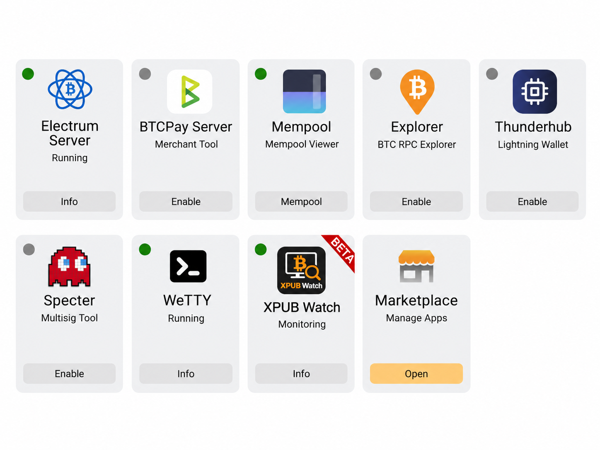
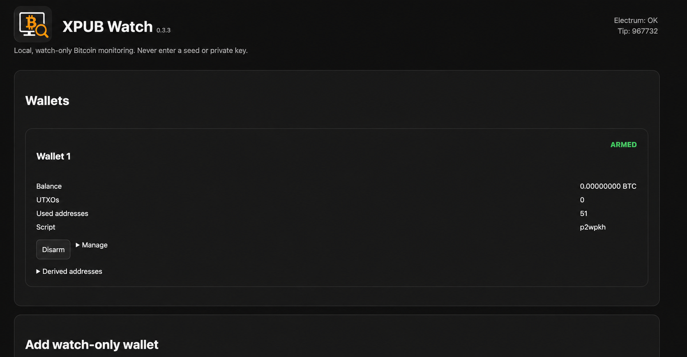

# XPUB Watch


XPUB Watch is a local, watch-only Bitcoin monitoring application for MyNode. It monitors one or more account-level `xpub` / `ypub` / `zpub` keys through the Electrum Server running on the same MyNode and can alert when funds are received or a known UTXO is spent.

> **Never enter a seed phrase, private key, hardware-wallet PIN, or BIP39 passphrase into XPUB Watch.**

## Status

**v0.5.0-beta.1** — hardening release (authentication, transaction ledger, notification outbox, persistent Electrum connection). See [CHANGELOG.md](CHANGELOG.md).

The 0.4 receive, spend, mempool, confirmation-tracking, multi-wallet, MyNode Community App installation and Telegram notification flows were field-tested on MyNode. 0.5 is covered by an automated test suite and needs the same field test before it replaces 0.4 (see [PUBLISHING.md](PUBLISHING.md)). See [Known limitations](#known-limitations) before exposing the web UI beyond a trusted local network.

## Features

- Multiple watch-only wallets
- `xpub`, `ypub`, `zpub` account keys
- BIP44 legacy (`1...`)
- BIP49 nested SegWit (`3...`)
- BIP84 native SegWit (`bc1q...`)
- Receive and change address discovery
- Dynamic look-ahead scanning
- UTXO tracking
- Receive events
- Spend detection from the mempool
- Spending transaction ID resolution
- Confirmation counting
- Detection of replaced (RBF) and dropped transactions
- Silent initial sync of funded wallets
- Password-protected web UI with CSRF protection
- ARMED / DISARMED state per wallet
- Telegram notifications
- Optional ntfy / Gotify notifications
- Configurable receive / spend / confirmation alerts
- Optional "ARMED wallets only" notifications
- Local SQLite persistence
- Local Electrum Server usage — no public blockchain API required
- MyNode Community App package

## Architecture

```text
xpub / ypub / zpub
        │
        ▼
   XPUB Watch
        │
        ├── BIP32 address derivation
        ├── receive/change discovery
        ├── UTXO state
        ├── event engine
        └── notifications
        │
        ▼
127.0.0.1:50001
 MyNode Electrum Server
        │
        ▼
   Bitcoin Core
```

XPUB Watch never needs signing keys. The extended public key is sensitive privacy data, however, because it can reveal the transaction history and derived addresses of the corresponding account.

## Screenshots

### MyNode integration



### Web interface



## Requirements

- MyNode with dynamic / Community App support
- Bitcoin Core synced
- Electrum Server (`electrs`) installed and running
- Network access from MyNode for optional Telegram / ntfy / Gotify notifications

## Installation on MyNode

Download the Community App archive from the GitHub Release and install it through:

```text
MyNode → Marketplace / Community Apps → Add Application
```

Upload:

```text
xpubwatch-mynode-community-app-<version>.tar.gz
```

Verify the archive against `SHA256SUMS` from the same release before uploading:

```bash
sha256sum -c SHA256SUMS
```

After installation open XPUB Watch from the MyNode dashboard and **set the access password immediately**. Until a password is set, anyone who can reach the page could set it.

Persistent application data is stored at:

```text
/mnt/hdd/mynode/xpubwatch
```

Application code is installed at:

```text
/opt/mynode/xpubwatch
```

## Adding a wallet

Use an **account-level extended public key**, not a seed.

Network and script type are taken from the key prefix where possible:

| Key prefix | Script type | Typical address |
|---|---|---|
| `zpub` / `vpub` | Native SegWit (BIP84) — automatic | `bc1q...` |
| `ypub` / `upub` | Nested SegWit (BIP49) — automatic | `3...` |
| `xpub` / `tpub` | select explicitly (BIP84, BIP49 or BIP44) | depends |

A selection that contradicts the prefix, a key that is already watched, private keys and multisig keys (`Ypub`/`Zpub`) are rejected.

After adding a wallet, the UI shows the first receive address. Verify it and several further derived addresses against the source wallet before relying on alerts.

The first scan records existing funds and history silently and logs one `sync` event. Alerts start with the next change.

## Alert types

| Event | Meaning | Severity (ARMED) | Toggle |
|---|---|---|---|
| `receive` | new output to a wallet address | info | Receive alerts |
| `receive_dropped` | an incoming transaction disappeared (dropped, replaced or reorganised) | warning | Receive alerts |
| `spend` | a known UTXO is spent (mempool or confirmed) | critical | Spend alerts |
| `spend_replaced` | the spending transaction was replaced (RBF / conflict) | critical | Spend alerts |
| `spend_reverted` | the spending transaction disappeared; the UTXO is unspent again | warning | Spend alerts |
| `spend_confirmed` | the spending transaction got its first confirmation | critical | Spend confirmation alerts |
| `sync` | initial sync of a wallet finished | info | (no notification) |

DISARMED wallets record the same events with severity `warning` instead of `critical`; with "Only notify for ARMED wallets" they send no notifications.

Notifications are written to an outbox in the same database transaction as the event and delivered afterwards. Failed channels are retried with backoff (up to 10 attempts) without duplicating messages on channels that already succeeded.

## Telegram setup

1. Create a bot with Telegram `@BotFather`.
2. Start the bot and send it a message.
3. Obtain the chat ID using the Telegram Bot API.
4. Enter the bot token and chat ID in XPUB Watch.
5. Use **Send test notification**.

The bot token is stored locally in the XPUB Watch SQLite database. It is never shown again in the UI after saving (leave the field empty to keep it, tick "Remove" to delete it). It is not embedded in the source code or release archive.

Example spend notification:

```text
🚨 XPUB Watch — SPEND

Wallet: Coldcard Main
Amount: 5,000 sat (0.00005000 BTC)
Status: MEMPOOL / unconfirmed
Confirmations: 0
TXID: …
Mempool: https://mempool.space/tx/…
```

## Security model

The web UI requires a password (PBKDF2-SHA256), protects every form with a CSRF token, throttles failed logins and sends a strict Content-Security-Policy. The session cookie is `HttpOnly`, `Secure` and `SameSite=Strict`.

XPUB Watch is watch-only. A compromise of XPUB Watch must not provide signing capability because the application does not require private keys.

However, a compromise can expose:

- account xpub / ypub / zpub values
- derived addresses
- balances and transaction history
- wallet labels
- notification configuration and tokens stored locally

Read [SECURITY.md](SECURITY.md) before deployment.

## Privacy model

Blockchain queries are sent to the Electrum Server on the same MyNode by default:

```text
127.0.0.1:50001
```

XPUB Watch does not submit xpubs to public blockchain APIs.

Optional notification channels necessarily disclose alert metadata to their service provider. Telegram alerts can include wallet label, amount, status, TXID and a transaction link.

## Backup

Before upgrades or major changes, back up:

```text
/mnt/hdd/mynode/xpubwatch/xpubwatch.db
/mnt/hdd/mynode/xpubwatch/flask_secret
```

Stop the service first for a consistent SQLite backup:

```bash
sudo systemctl stop xpubwatch
sudo cp -a /mnt/hdd/mynode/xpubwatch /path/to/secure/backup/
sudo systemctl start xpubwatch
```

Treat the backup as sensitive because it can contain xpubs and notification credentials.

## Upgrade

Upload the newer Community App archive through MyNode. The storage directory under `/mnt/hdd/mynode/xpubwatch` is preserved by normal upgrades.

Always verify after an upgrade:

```bash
cat /home/bitcoin/.mynode/xpubwatch_version
systemctl status xpubwatch --no-pager
```

## Upgrading from 0.4

- Upload the new archive as described above. Wallets, events and settings are kept.
- On the first visit after the upgrade you are asked to set an access password.
- The database is migrated automatically (backup first, see above). Each wallet is re-synchronised once: history unknown to 0.4 is recorded silently, but a spend of a UTXO that 0.4 already tracked still raises an alarm.
- Notification tokens are no longer displayed; they remain stored.

## Reset the password

```bash
sudo -u bitcoin XPUBWATCH_DATA_DIR=/mnt/hdd/mynode/xpubwatch \
  /opt/mynode/xpubwatch/.venv/bin/python /opt/mynode/xpubwatch/manage.py reset-password
```

Then open XPUB Watch and set a new password immediately.

## Uninstall

Use the MyNode application management UI. The exact data-retention behavior should be checked before uninstalling; back up `/mnt/hdd/mynode/xpubwatch` first if the data must be retained.

## Troubleshooting

### Electrum timeout

Check the local port:

```bash
sudo ss -ltnp | grep 50001
```

Direct test:

```bash
cd /opt/mynode/xpubwatch
sudo -u bitcoin .venv/bin/python
```

```python
from electrum_client import ElectrumClient
c = ElectrumClient("127.0.0.1", 50001)
print(c.tip())
```

### Service logs

```bash
journalctl -u xpubwatch -n 100 --no-pager
```

## Known limitations

- Public beta; not independently security-audited.
- The first visitor after installation sets the password. Set it right away.
- Web UI is intended for a trusted local MyNode environment. Do not expose the XPUB Watch ports directly to the public Internet.
- Single-signature accounts only (no multisig / descriptors).
- Notification secrets are stored locally in SQLite. Protect MyNode backups and filesystem access.
- Taproot / BIP86 account monitoring is not yet implemented.
- XPUB Watch detects unauthorized-looking spends but cannot prevent a valid transaction signed with compromised private keys.
- A mempool alarm does not guarantee there is enough time to rescue funds.

## Development

The MyNode Community App source is in:

```text
mynode-app/xpubwatch/
```

Run the tests and release checks:

```bash
python3 -m pip install -r requirements-dev.txt
python3 -m pytest
./scripts/validate-release.sh
```

The tests use an in-memory Electrum backend (`tests/fake_electrum.py`) and a local Electrum protocol server (`tests/electrum_server.py`); no node is required.

Build the Community App archive (reproducible):

```bash
python3 scripts/build-release.py dist
```

Release: `scripts/set-version.sh <version>`, add the CHANGELOG entry, commit, tag `v<version>`. The `Release` workflow tests, builds and publishes the archive and `SHA256SUMS` as a GitHub release.

## License

MIT. See [LICENSE](LICENSE).
